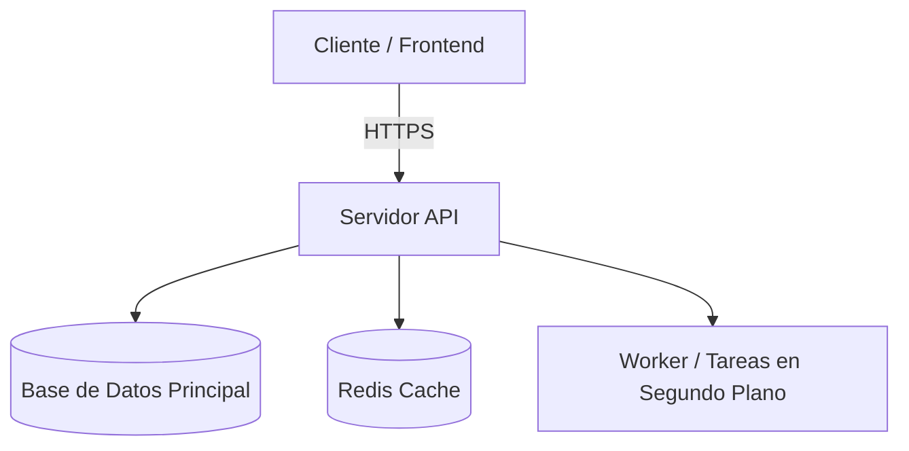

> Last Updated: YYYY-MM-DD | Version: 1.0 | Sprint: [sprint-name]

# [Project Name] — Team Reference (Memoria Interna del Proyecto)

> **Nota para el equipo interno**: Documento que captura las decisiones arquitectónicas (ADRs), mapa de responsabilidades, contratos de datos y deuda técnica consciente.

---

## 1. Diagrama de Arquitectura Actual

---

## 2. Decisiones de Arquitectura Registradas (ADRs)

### ADR-001: [Título de la Decisión]
- **Fecha**: YYYY-MM-DD | **Estado**: Activo
- **Contexto**: [Qué problema motivó esta decisión]
- **Decisión**: [Qué se decidió implementar]
- **Consecuencias**:
  - ✅ Beneficios obtenidos.
  - ⚠️ Limitaciones asumidas o trade-offs.

---

## 3. Mapa de Módulos y Responsabilidades

| Directorio / Módulo | Responsabilidad Principal | Patrón Utilizado |
| :--- | :--- | :--- |
| `src/modules/auth/` | Autenticación, JWT, RBAC | Service + Repository |
| `src/modules/billing/` | Integración con Stripe / Webhooks | Idempotencia en eventos |
| `src/shared/ui/` | Componentes reutilizables de UI | Tokens CSS + Atomic Design |

---

## 4. Deuda Técnica Activa

| ID | Descripción | Ubicación | Impacto / Riesgo | Prioridad |
| :--- | :--- | :--- | :--- | :--- |
| `DEBT-001` | [Descripción concisa del workaround] | `[archivo/módulo]` | [Qué puede fallar si no se resuelve] | Alta / Media / Baja |

---

## 5. Protocolo de Incidentes y Recuperación

### Error 500 o Caída del Servidor:
1. Inspeccionar logs: `docker logs [nombre-contenedor] --tail 100`
2. Verificar conectividad a base de datos y memoria disponible (`free -m` / `df -h`).
3. En caso de despliegue defectuoso reciente, ejecutar rollback a la versión previa.

